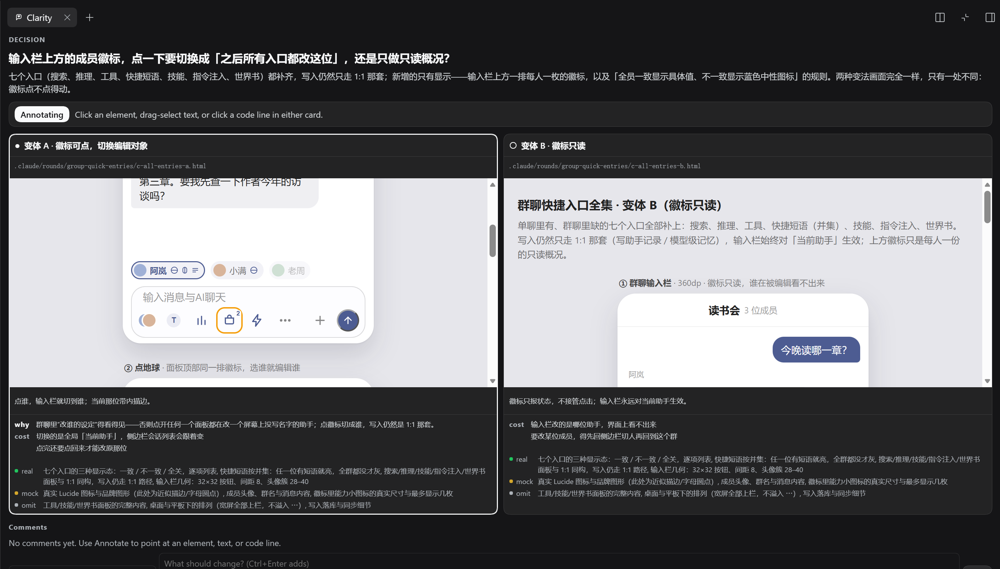

<div align="right">English | <a href="README.zh-CN.md">中文</a></div>

# Collaborative Clarity

<p>
  <a href="https://www.npmjs.com/package/@ds-hu/dsh-collaborative-clarity"></a>
  <a href="https://www.npmjs.com/package/@ds-hu/dsh-collaborative-clarity"></a>
  <a href="LICENSE"></a>
  
</p>

**Work with the agent inside a right-sidebar tab: instead of a hundred lines of plan, you get the
demo and the reasoning in front of you.**



## What goes wrong when you vibe code

Handing the build to an agent is fast, and three things go wrong every time.

- **You cannot control the UI before it exists.** The agent decides on its own how a screen behaves;
  when it is not what you pictured, the only way back is rework. **`clarity_round` puts the UI in
  front of you before it is built, so you can point at what to change.**
- **The architecture quietly becomes someone else's.** Hand the code over and the map goes with it:
  which choice is risky, what it costs, why it was made — you learn all of that when a user does.
  **`clarity_round` puts the reasoning, the cost, and the few lines of pseudocode that matter in
  front of you, so the project stays yours.**
- **The unit tests pass and it still breaks in production.** An agent writes unit tests well; what
  it cannot do is the thing a developer does while building — run it, by hand, again and again.
  **`clarity_test` makes sure a change went through your own test before it ships, and takes your
  screenshots and notes when it did not.**

## Why it works

**HTML goes anywhere.** It is the cheapest thing to render and the widest: a terminal, a diff, a
table, a screen. Parts that do not matter can be left out of the replica; what matters is having a
picture of your own product before it is built.

**The two halves are good at opposite things.** Every extra turn makes an agent re-read a longer
context and drift a little; what it does very well is produce a 20 KB HTML file in one pass. A
person is the reverse: nobody writes a finished page from nothing in one sitting, and nobody wants
to rewrite one that already exists. `clarity_round` spends the agent's pass on what it is good at,
and your attention on the judgement it cannot supply.

**A person has to sign off.** Whatever ships ends up in front of a user, so somebody has to have
used it first — on the real build, with their own eyes, before the user does.

## `clarity_round`: a decision you can see

1. **The agent puts the proposal on screen.** Two variants at most, each of them rendered rather
   than described.
2. **You mark what you disagree with.** Click an element, drag-select a phrase, or click a line. The
   agent knows which part of the screen a note belongs to, so the fix lands where you meant it.
3. **You decide before anything is implemented.** Accept, revise, or reject, until the direction is
   unambiguous.
4. **The agent implements the verdict.** After a round you already know what you are getting, so the
   finished thing cannot blindside you.

## `clarity_test`: a real test before it ships

`clarity_test` asks you to build the change and try it, tells you what passing looks like, and
records what you found. When it does not pass, you answer with words and screenshots. Nothing ships
without having been run by the person who asked for it.

## Install

```powershell
dsh plugin --profile web add @ds-hu/dsh-collaborative-clarity      # web UI
dsh plugin --profile desktop add @ds-hu/dsh-collaborative-clarity  # desktop
```

Pick the profile that matches your host. From GitHub, use
`github:ds-hu/dsh-collaborative-clarity` instead. There is no build step and one runtime dependency
(`markdown-it`). Non-blocking rounds also need `@deepseek-ai/dsh-tool-jobs` in the profile.

## Read more

- [AGENTS.md](AGENTS.md) — the architecture, the rules, the tests.
- [docs/collaboration-draft/](docs/collaboration-draft/README.md) — what the author was thinking
  while building it.
- [CHANGELOG.md](CHANGELOG.md) — what each version changed.

---

Apache License 2.0. See [LICENSE](LICENSE).
