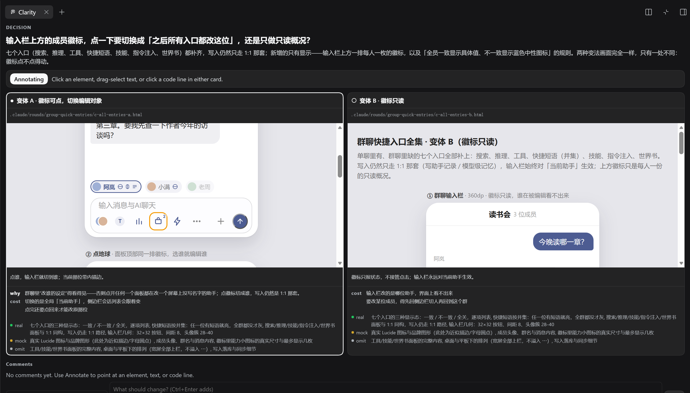

<div align="right"><a href="README.md">English</a> | 中文</div>

# Collaborative Clarity

<p>
  <a href="https://www.npmjs.com/package/@ds-hu/dsh-collaborative-clarity"></a>
  <a href="https://www.npmjs.com/package/@ds-hu/dsh-collaborative-clarity"></a>
  <a href="LICENSE"></a>
  
</p>

**在一个右边栏标签页中与 AI 协作，不读一百行的计划文本，而是让它把 demo 和逻辑呈现给你看**



## Vibe coding 会踩的坑

让 agent 写代码很快，但容易出现问题：

- **开发者无法事先控制 UI**。屏幕怎么表现，agent 自己就定了，不尽人意，只能来回返工。**`clarity_round` 让你在实现前就对 UI 效果心里有数，并能针对性调整**。
- **开发者逐渐不熟悉架构**。把代码完全交给 agent，你就不知道哪个选择有风险、代价多大，甚至当初为什么这么定，都得等用户替你发现。**`clarity_round` 会把关键的原因和代价，甚至关键伪代码，都给你过目，让开发者充分了解自己的项目**。
- **通过了单测，上线后问题频出**。AI 擅长写单元测试，但无法像人类一样在开发时手动反复测试。**`clarity_test` 保证代码提交前经过了你的实测审阅，并允许你用截图和文字及时反馈**。

## 为什么这个插件有用

**HTML 的通用性**。HTML 最好渲染，也装得下各种东西：终端、diff、表格、界面，都能画。非关键的部分在复刻时可以省略，关键在于你对自己产品的 UI 有预先的认知。

**人机长处互补。** agent 每多一轮就要重读越来越长的上下文，还会跑偏；但它一次能写出一个 20KB 的 HTML 文件。而人恰好相反：没人能一口气从零写出一整页 HTML，更没人愿意在已经有实现的情况下重写一份。`clarity_round` 把 agent 的一次生成用在它擅长的地方，把你的注意力用在它替不了的判断上。

**人必须把关产品**。东西最终是给用户用的，那就得有人赶在用户之前，在真实构建上，用自己的眼睛看。

## `clarity_round`：可视化的决策

1. **agent 提交方案**。最多两个变体，每个都不只有描述，还有真实渲染出的结果。
2. **你来标注出不同意的地方**。点一个元素、划一句话、点一行代码都行，AI 会知道你的意见对应的是哪一块区域，从而能进行针对性修改。
3. **你在实现前拍板**。或接受，或修改，或拒绝，直到明确实现方向。
4. **agent 根据结论实施**。在 `clarity_round` 后，你就对 AI 给出的东西有了基本认知，不会在看到成品时惊掉下巴。

## `clarity_test`：上线前的实测

`clarity_test` 会要求你构建并实测一遍，给你提供测试的成功标准，由你把结果记下来。如果没有通过，可以用文字和截图反馈。确保每个上线功能，都经过了开发者的实测。

## 安装

```powershell
dsh plugin --profile web add @ds-hu/dsh-collaborative-clarity   # webui
dsh plugin --profile desktop add @ds-hu/dsh-collaborative-clarity   # desktop
```

根据你是 Web UI 还是桌面端选取对应命令。若想从 GitHub 装，就换成 `github:ds-hu/dsh-collaborative-clarity`。没有构建步骤，运行时只有一个依赖（`markdown-it`）。非阻塞 round 还需要 profile 里有 `@deepseek-ai/dsh-tool-jobs`。

## 更多参考

- [AGENTS.md](AGENTS.md): 架构、规矩、测试。
- [docs/collaboration-draft/](docs/collaboration-draft/README.md): 本项目开发过程中开发者的想法。
- [CHANGELOG.md](CHANGELOG.md): 版本更新日志。

---

Apache License 2.0，见 [LICENSE](LICENSE)。
