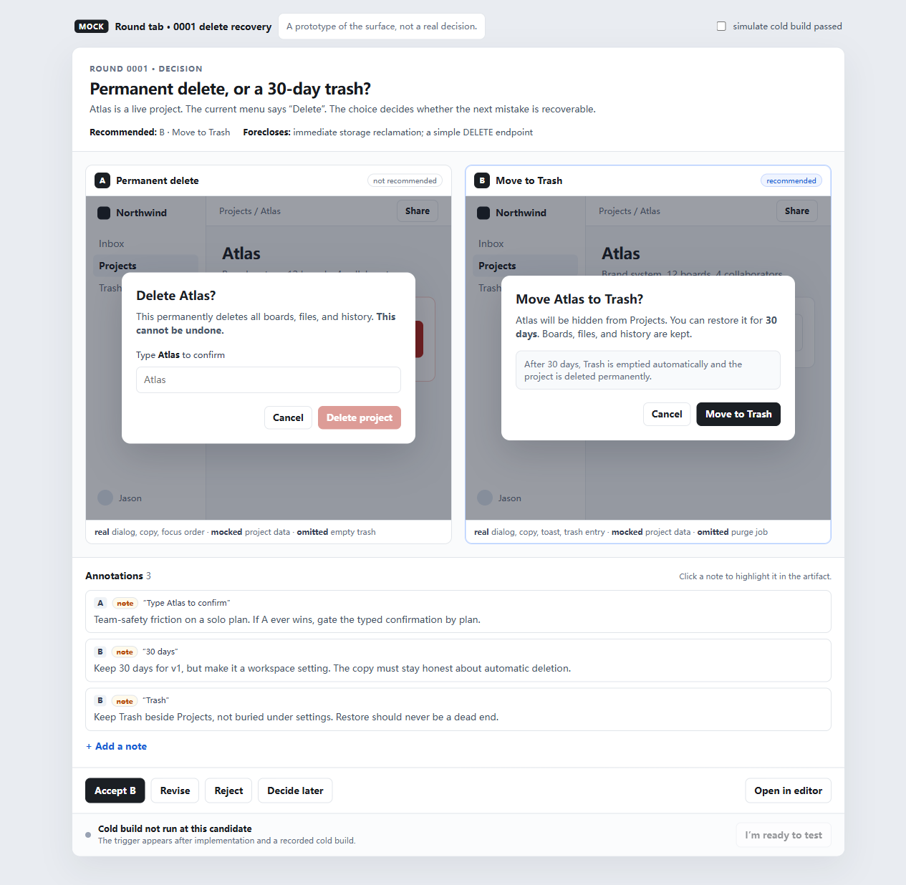

# Example — a round you can look at

This is an **illustrative example**, not a real decision. The project (“Atlas”) and the
people are invented. There is no cold build and no test record.

It exists to make the surface concrete: two variants, a recommendation, a foreclosure, a
few annotations, a decision, and the test gate.

## Open it



Open [round.html](round.html) in a browser. It loads the two variants in iframes.

If your browser blocks local iframes, serve the directory over HTTP:

```powershell
python -m http.server 4173 --directory docs/collaboration-draft/example
```

Then open <http://127.0.0.1:4173/round.html>.

The variants also open on their own: [variant-a.html](variant-a.html) and
[variant-b.html](variant-b.html). They are self-contained: no network, no build.

## What to try

1. **Click a note** in the annotation rail. The anchored element is outlined in the
   artifact.
2. **Add a note** (prototype: it attaches to the whole variant). The rail updates.
3. **Accept B**. A mock decision record appears with the structured result the tool would
   return.
4. **Simulate cold build passed** in the top bar, then press **I’m ready to test**. The
   test sheet shows the scenario, the expected observable, and the failure signature; the
   run is mocked.
5. **Revise**, **Reject**, and **Decide later** show the other result shapes.

Everything in the top bar marked **MOCK** is a prototype control. It does not claim that a
build ran or that a test passed.

## The story

The product is about to ship a project delete. The current menu says “Delete”. The agent
opens a round with two honest variants:

- **A — Permanent delete.** A typed-name confirmation, then the project is gone.
- **B — Move to Trash.** A 30-day Trash with restore, then permanent deletion.

The recommendation is B. The foreclosure is explicit: Trash costs storage for 30 days, a
purge job, and a link-handling round. The user accepts B and adds three notes. The notes
become implementation constraints, not a rewrite of the artifact.

## Files

| File | What it is |
|---|---|
| [round.md](round.md) | The manifest the tool would receive: decision, variants, recommendation, foreclosures |
| [variant-a.html](variant-a.html) | Permanent delete, self-contained |
| [variant-b.html](variant-b.html) | Move to Trash, self-contained |
| [annotations.jsonl](annotations.jsonl) | The three annotations, append-only |
| [decision.md](decision.md) | The decision record, including resolutions and follow-ups |
| [round.html](round.html) | The round tab mock: header, two viewports, rail, actions, test bar |

## What this example proves

- The decision can be shown without building the product.
- The two variants are honest about what is real, mocked, and omitted.
- An annotation can point at a word and change the implementation constraint.
- The decision record can be produced from the annotations, not from a chat summary.

## What it does not prove

- That the round tab is implementable in DSH. It is a static HTML mock, not a plugin.
- That the iframe annotation channel works under the DSH sandbox. The mock uses
  `postMessage` on a local page; the real tab must do it under `allow-scripts` without
  `allow-same-origin`.
- That the test trigger can run a command. It is mocked; [04](../04-verification.md)
  specifies the contract.
- That B is the right product decision. That is the user's call, and this example makes it
  for the sake of the story.
